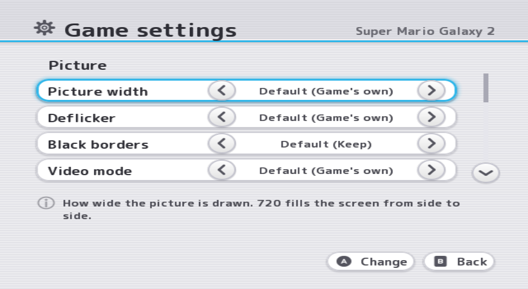

# Game settings opening check

Checked on 25 October 2026, against main at `21172fe0`.

Opening **Options** on a game's page used to build every settings row
with drawing stopped. That included checking whether a cover was on the
card. For a channel game it also checked where its installed copies were.
A slow file check therefore kept the old page on screen.

The page now draws the settings already in memory first. It reads the
remaining details with drawing running, then replaces the rows while
drawing is stopped briefly. The rows that need those details are blank
and dimmed until ready. Later refreshes also read with drawing running.
There is no persistent cache: a changed setting or a completed cover
download is checked again on the next refresh.

## Measurements

Both runs used Felk Dolphin, the test build, the same 128 MiB test card,
and Super Mario Galaxy 2 (`SB4E01`) from Dolphin's inserted disc. The card
had 12 matching XML packs, a 2,000-code cheat file, a titles file and a
stored cover. Packs and cheats were off; the network setting was on and
the menu was in English. `guiscript.txt` opened the disc, pressed Options,
returned, and opened Options again.

Temporary timing code recorded the scripted A press and the first frame
presented by `Menu_Render` after the settings window was attached. This
includes the start of the usual page transition, not its full 320 ms
animation. Temporary wrappers counted `fopen`, `fread`, `stat` and
`opendir` calls during the open. These are library calls, not physical
SD-sector counts. Timing and wrapper code were removed afterwards.

| From the A press to the first presented settings frame | Before | After |
| --- | ---: | ---: |
| Ordinary Dolphin card access | 33 ms | 34 ms |
| Cover check deliberately delayed by 2,000 ms | 2,019 ms | 33 ms |
| File opens before that frame | 0 | 0 |
| File reads before that frame | 0 | 0 |
| File status checks before that frame | 1 | 0 |
| Directory opens before that frame | 0 | 0 |

The ordinary run did **not** reproduce the console's multi-second delay.
The second run deliberately added `usleep(2000000)` around the settings
page's cover-file status check, before and after, to check what happens
when the card is slow. The check still happens after the change; it now
happens after the first frame, while drawing continues.

Before, row building took less than 1 ms normally and 2,000 ms with that
added delay. Widget construction and attaching the window each took less
than 1 ms. After, the initial rows took less than 1 ms in both runs; the
remaining read ran after the page was drawn. Opening Options did not
rescan XML, parse cheats, read profiles, load a banner or download files.
Those were not responsible for the measured wait.

## Checks

The 110 host suites passed, excluding `d2xreload`, `disccache_io` and
`d2xnandemu` as required on Windows. Both Wii builds, the channel build
and the translation check passed. A final run without the timing code changed picture width, reopened the page with that choice still selected, and showed the stored cover as "Download again". No new menu text was added. There is
no configured formatter or linter; the existing tab indentation and style
were followed by hand.

Real-console timing still needs a check. The channel-copy check was
moved out of the opening path too, but these timing runs used a disc game.
