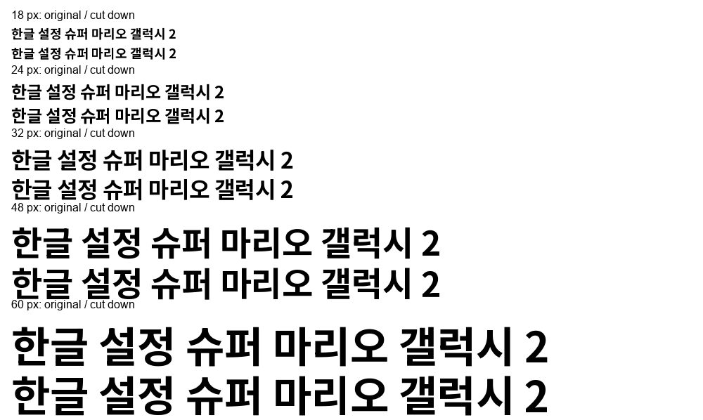
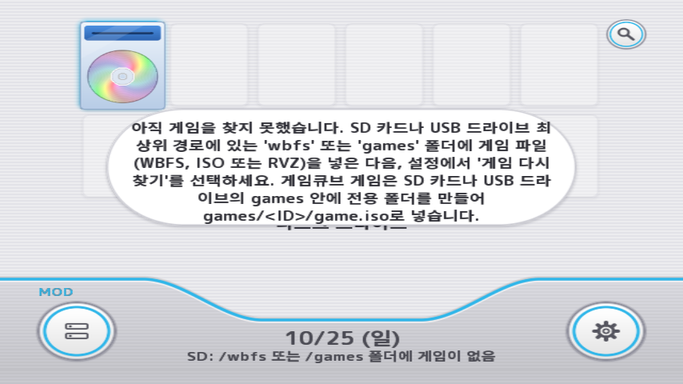
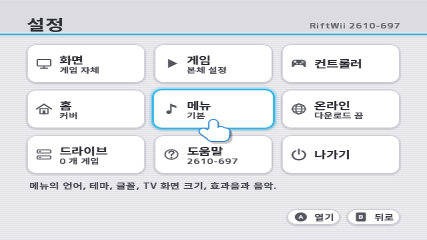
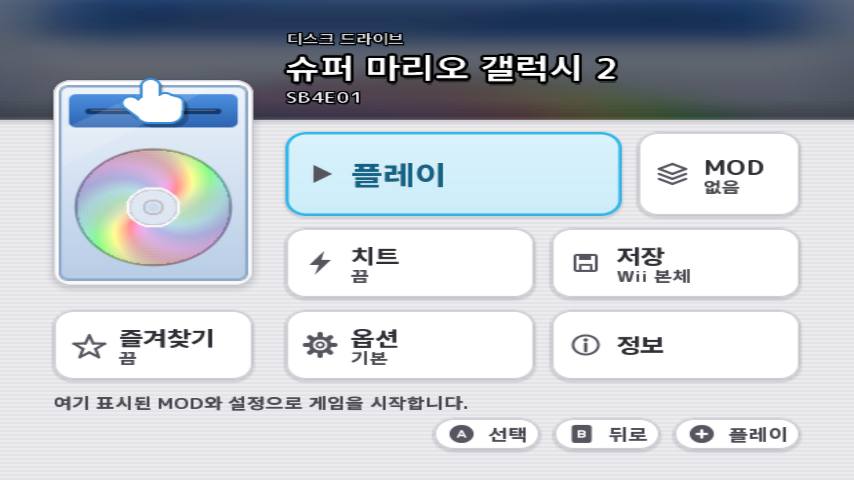
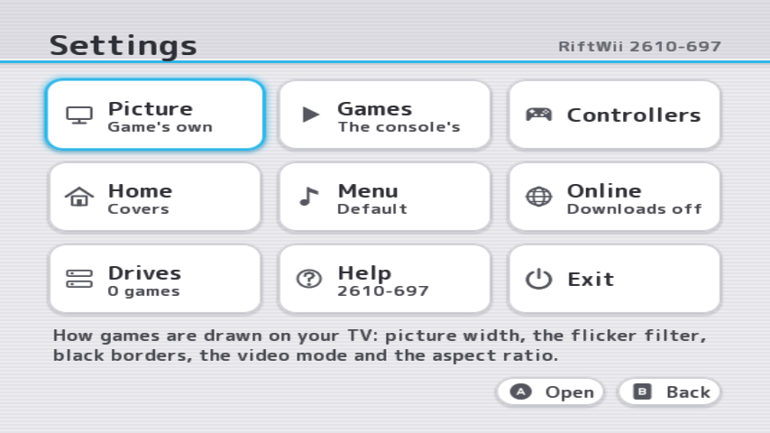

# Korean menu font

`apps/riftwii/korean.ttf` supplies characters missing from the main
menu font. It ships beside `boot.dol`, with `Korean-OFL.txt`, in
both the release zip and update pack. The update writes both fonts and
the Korean license before replacing the DOL, including in a renamed app
folder. Nothing from the Korean font is embedded in the DOL.

The source is **Noto Sans KR**, version 2.004-H2, fixed at weight 700.
Its bold weight is retained alongside the M PLUS 1 SemiBold menu face. NanumSquare Round Bold was
checked first: its rounded shapes fit the menu, but its official font
has no conjoining Hangul Jamo. Noto covers those as well as the common
syllables. The license is SIL Open Font License 1.1; the modified font
is named **RiftWii Korean**. Adobe's copyright and license are preserved.

## Rebuilding

Download `NotoSansKR[wght].ttf` from the official Google Fonts
[pinned source](https://github.com/google/fonts/tree/b38c5c93af322c45f633e17ac440ec1e6c94d489/ofl/notosanskr).
The script checks its SHA-256:
`194018e6b2b293a7964f037b25c0249ce1418bc9ab3c971060a03aa57861e252`.
Keep the original outside the tracked source tree. With fontTools installed:

```sh
python tools/make_korean_font.py NotoSansKR.ttf wii/font/korean.ttf
```

This keeps all 2,350 KS X 1001 syllables, the assigned conjoining,
compatibility and extended Jamo ranges, every printable character of
`wii/lang/ko.po`, and the Korean GameTDB title snapshot recorded as code
points in `tools/korean_title_chars.txt`. `wii/online/online.cpp` uses
GameTDB's `LANG=KO` list for `sd:/riftwii/titles-ko.txt`. Its snapshot
includes two syllables beyond KS X 1001, U+D019 and U+D6D5. To add a
newer title list's characters, pass `--titles titles-ko.txt`; repeat the
option for other UTF-8 lists. Update the manifest when refreshing it.

The script fixes the variable weight, removes hinting, kerning and
unused layout and vertical tables, moves simple outline points to an
8-unit grid (1,000 units per em), recomputes bounds without changing
advances, and removes redundant implied on-curve points. It preserves
the TrueType format used by FreeType.

| Font | Bytes |
| --- | ---: |
| Official variable font | 10,414,588 |
| Generated font, 2,919 characters | 468,080 |

That is 95.5% smaller before zip compression. The generated SHA-256 is
`211e1d09710cfc753c38c8b499d62a44d4c7ece1f6ba990930d6477d5f98a1cf`;
regenerating from the pinned source and manifest produces the same bytes.



## Runtime

`wii/menu/fullfont.cpp` retains the complete M PLUS 1 menu face in MEM2.
Korean's separate `korean.ttf` is also read completely into MEM2 on first
use, with its file immediately closed. Its FreeType face, temporary glyph
bitmap and glyph textures share the existing 384 KiB MEM2 pool, with heap
overflow as before. The Korean language check loads this face before
choosing the translation, without rasterizing a glyph.

Close holds now prevent new card reads during unmounts and updates;
already loaded faces remain drawable, including characters not yet cached.
The main face is read again only at the next menu start. A missing Korean
font is retried after a remount, and Korean still falls back to English
with the existing notice. The Wii Menu selection retains its own coverage
check. The measurements below describe the former streaming implementation.

## Verification, 25 October 2026

- All 113 host tests passed. `menufont` checks every printable `ko.po`
  character, Jamo, the extra title syllables, rounding and removed
  tables. The translation check also checks all 2,350 common syllables
  and every character in the title manifest. All current GameTDB KO
  title characters were checked against the generated font.
- Both Wii builds and the channel build passed. On this machine the
  host build needs `-DCMAKE_CXX_FLAGS=-D_DEFAULT_SOURCE` because the
  existing `di.cpp` test builds otherwise cannot see MSYS's `usleep`.
  No formatter or linter is configured; surrounding style was matched
  by hand, with `git diff --check`, Python compilation and project rules.
- Felk Dolphin, isolated profile and SD cards, test DOL: Korean Home,
  Settings, and the game page for Super Mario Galaxy 2 (SB4E01).
  The game launched to its wrist-strap screen. A separate `failnext`
  launch returned through RiftWii's warm restart to Korean Settings.
  Its log records `Restarted: The launch failed: a test failure the
  guiscript asked for` followed by a new Korean font open.
- Each menu session logged one Korean font open, including the returned
  session. The successful launch's log recorded both fonts closed with
  `the menu closed` before boot. The missing-file card logged exactly
  one `Copy apps/riftwii/korean.ttf from the RiftWii zip to the SD card.`
  diagnostic and showed usable English Settings.

The captures below are Dolphin frames, displayed at 854 by 480 for 16:9.






Matched release builds at the same version stamp (2610-697), identical
title lists, default theme, no game opened, after dismissing What's new:

| Menu | MEM2 free on Home, KiB | MEM2 free in Settings, KiB |
| --- | ---: | ---: |
| Before, English | 35,937 | 35,932 |
| After, English | 35,937 | 35,932 |
| After, Korean | 35,309 | 35,304 |

The Korean menu uses 628 KiB more here, including its catalog and cached
glyphs. The font shares the existing pool instead of reserving another
384 KiB. MEM1 usage reported at these points was unchanged. The packed
release DOL grew from 2,145,408 to 2,145,952 bytes, 544 bytes including loading
code and the translated missing-font note, without embedding the font.

Real-console checks remain: SD and USB card timing, d2x image launches,
and the Wii Menu font on a Korean Wii. Dolphin cannot verify those.
