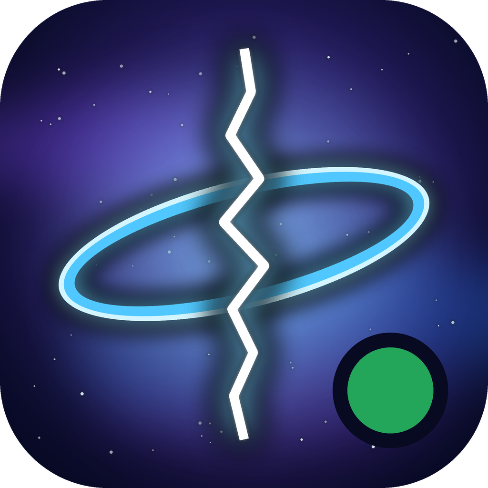

<p align="center"></p>

# RiftWii-RPC

Shows the game you are playing in RiftWii on your Discord profile, like
Dolphin does for its games: the game's name, its cover, your mods and how
long you have been playing. It runs on the computer where Discord is open,
on the same network as the Wii. Nothing to set up on the Wii: RiftWii
already tells the network what it is playing.

How it works, and why, is in [docs/PRESENCE.md](../docs/PRESENCE.md).

## Using it

1. Download it from the release (Windows, macOS as one app for Apple
   silicon and Intel Macs, macOS 13 or later; Linux), or build it (below).
2. Start it with Discord open. On macOS, the release's app is not
   notarised by Apple: the first time, right-click it and choose Open.
   Then allow it to find devices on your local network when asked: the
   Wii's messages come from there.
3. If it asks for a Discord application ID, make one (next section) and
   paste it in.
4. Start RiftWii on the Wii. Its menu shows up within half a minute, and a
   game as soon as you choose Play.

Closing the window keeps it running in the tray (the menu bar on macOS).
"Start when I log in" starts it there each time; `--background` does the
same by hand.

A game stays on Discord until RiftWii is back in its menu, RiftWii closes,
or **Keep a game shown for** runs out: the Wii can say nothing while a game
runs, so a Wii switched off in the middle of a game is noticed only then.
Choose a time a bit longer than you usually play.

With several Wiis on the network, pick yours under **Wii**.

## The Discord application

Discord shows the name of an application from its Developer Portal
("Playing RiftWii"). Builds from RiftWii's releases may have one built in.
Otherwise make your own, once:

1. Go to https://discord.com/developers/applications and choose **New
   Application**.
2. Name it **RiftWii**. Not "Dolphin Emulator", "Cemu", "Nintendo 3DS",
   "Nintendo Switch", "Switch", "Yuzu", "Ryujinx", "citra" or anything with
   "(3DS)" in it: RiiConnect24's RiiTag bot reads presences with those
   names and would count your plays twice (RiftWii updates RiiTag itself).
3. Optionally give it `icons/riftwii-rpc.png` as its icon.
4. Copy the **Application ID** from **General Information** into
   RiftWii-RPC.

That is all. Nothing needs uploading under **Rich Presence > Art Assets**:
the covers come from GameTDB, and the small icon from this repository.

## Running without a desktop

`RiftWii-RPC --headless` runs without a window or tray and logs to the
terminal, for a machine that runs Discord but no desktop session you look
at. `--client-id <id>` gives the application ID for that run, `--port`
another UDP port (the Wii sends to 51130).

## On the Wii

Nothing to do. Two lines in `sd:/riftwii/settings.txt` change what RiftWii
sends:

```
presence = off                 # send nothing
presence_host = 192.168.1.20   # also send straight to this computer
```

`presence_host` is for networks that drop broadcasts between devices (some
mesh Wi-Fi systems, guest networks, "client isolation"). With Settings >
Online off, RiftWii sends nothing either.

## Building

Qt 6.2 or later (Core, Network, Widgets; Test for the tests) and CMake:

```bash
cmake -S rpc -B build-rpc -G Ninja -DRIFTWII_RPC_CLIENT_ID=<application ID>
cmake --build build-rpc
ctest --test-dir build-rpc --output-on-failure
```

`RIFTWII_RPC_CLIENT_ID` is the application ID built in as the default
(empty: the player pastes one). `RIFTWII_RPC_TESTS=OFF` leaves the tests
out. On macOS, `-DCMAKE_OSX_ARCHITECTURES="arm64;x86_64"` with a universal
Qt (Qt's online installer's, or `aqtinstall`'s) makes a Universal 2 app;
Homebrew's Qt is for one architecture only. CI builds all three systems
when asked (`.github/workflows/ci.yml`, "RiftWii-RPC").

`icons/make_icon.py` draws the icon again (Pillow; `.icns` on a Mac only).
